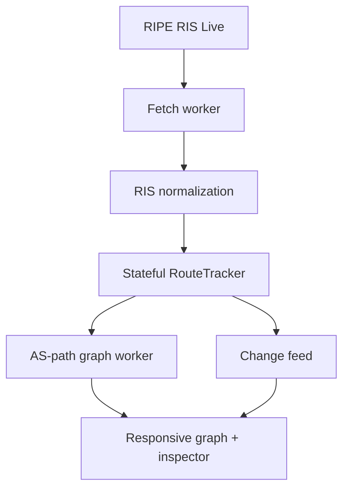

# TopoLens

TopoLens is a mobile-ready, browser-only tool for watching live BGP topology changes. It consumes the [RIPE RIS Live](https://ris-live.ripe.net/) WebSocket stream, tracks route state for the current browser session, and turns AS-path changes into an explorable graph, change feed, and inspector.

There is no backend, database, account, or BGP daemon. The production build is a static Vite application that can be hosted on GitHub Pages.

## What TopoLens shows

- A live AS-level graph derived from observed `AS_PATH` adjacencies.
- A chronological change feed for first observations, path changes, origin changes, known withdrawals, and unmatched withdrawals.
- A detail inspector with the previous and current route, origin, and edge diff for a selected change.
- A configurable RIPE RIS scope: route collector, IPv4/IPv6 prefix, and AS-path filter.
- A RIPEstat-backed network-name search that resolves organizations such as Facebook to explicit
  ASN candidates before starting an origin-scoped live session.
- Explicit connection, reconnecting, warming, partial-data, retention, and error states.
- Touch-friendly controls and responsive layouts for phones, tablets, and desktop browsers.
- Bounded in-memory route and change buffers so a long-running tab cannot grow without limit.

## Read the data honestly

TopoLens is a **live session observer**, not a complete view of the global routing table.

It intentionally does not load a RIB snapshot. When a session starts, the route tracker is empty and learns only from updates that arrive after the subscription becomes active. The first announcement for a `(collector, peer, prefix)` key establishes a local baseline; it does **not** prove that the route was newly announced on the internet.

| UI term                 | Meaning                                                                                                                    |
| ----------------------- | -------------------------------------------------------------------------------------------------------------------------- |
| **Warming**             | The session is still establishing baselines from live updates. No historical route state was loaded.                       |
| **Partial**             | The view contains only this collector, the selected scope, the observed time window, and entries still retained in memory. |
| **First observed**      | The first announcement for a route key in this session, not necessarily a global route creation.                           |
| **Path changed**        | A later announcement changed the normalized AS path relative to the last retained route state.                             |
| **Origin changed**      | A later announcement changed the final, unambiguous origin ASN.                                                            |
| **Withdrawn**           | A withdrawal matched a route already known in this session.                                                                |
| **Withdrawal observed** | A withdrawal arrived without a matching local baseline. TopoLens does not invent the missing route or removed edges.       |

A disconnect creates an observation gap. Reconnection cannot backfill it, so the UI remains partial even if the socket reconnects successfully. Reloading the page starts a new in-memory session.

## Scope filters

TopoLens sends scope filters as part of the RIS Live subscription, reducing noise before it reaches the browser:

- **Collector**: a RIPE route collector such as `rrc00` or `rrc21`.
- **Prefix**: an IPv4 or IPv6 CIDR. Matching more-specific prefixes are requested as well.
- **AS path**: a single ASN or a RIS-compatible path expression.

Leaving prefix and path blank requests a broad collector stream. That can be noisy, especially on mobile hardware. Start with a prefix or ASN when investigating a specific network. Applying a different scope starts a fresh observation baseline; changes from incompatible scopes must not be compared as if they belonged to one continuous route state.

The **Find a network by name** control resolves a company or registered network name through the
[RIPEstat Searchcomplete API](https://stat.ripe.net/docs/data-api/api-endpoints/searchcomplete).
TopoLens always shows the returned ASN and registry description so you
can disambiguate names before choosing **Watch origin**. That action clears the prefix filter and
starts a fresh subscription using an origin-anchored path such as `32934$`; the resulting stream is
therefore limited to announcements whose observed AS path ends in the selected ASN. If RIPEstat is
unavailable, the live stream keeps running and you can enter an ASN or path expression manually in
the Scope dialog. Withdrawals generally have no AS path to match, so an origin-scoped session is an
announcement view rather than complete withdrawal history.

## Architecture



The route key is `collector + peer + prefix`. Announcements update that key in arrival order; withdrawals remove it when known. Graph edges come only from adjacent, unambiguous ASN segments. AS sets are preserved for display but are not expanded into made-up adjacencies, and AS-prepending does not create self-loop edges.

Network parsing and graph work run away from the React render path. Update batches, tracked routes, retained changes, and rendered graph data remain bounded. Eviction and dropped-history counters are surfaced rather than silently implying that the session is complete.

## Local development

Requirements:

- Node.js 22
- npm
- A browser with Web Workers, WebSocket, and WebGL support
- Network access to `wss://ris-live.ripe.net`

Install and start the development server from the repository root:

```bash
npm ci
npm run dev
```

Vite prints the local URL, normally `http://localhost:5173`.

Run the complete local quality gate before opening a pull request:

```bash
npm run typecheck
npm run lint
npm run format
npm run test
npm run build
```

Preview the production output locally:

```bash
npm run preview
```

## Testing

Unit tests use Vitest and cover the parts where incorrect behavior would create misleading topology claims:

- RIPE RIS message normalization and malformed payloads.
- Subscription normalization, validation, and payload construction.
- Stateful route transitions and route-key isolation.
- Exact AS-edge diffs, AS sets, prepending, withdrawals, and duplicate announcements.
- Route/change retention limits and truthful drop/eviction counters.
- Components and hooks where user-visible state or responsive behavior changes.

For manual verification, use both a narrow prefix/ASN scope and an unfiltered stream. Check reconnect behavior, empty/warming states, feed selection, graph interaction, and inspector dismissal at phone and desktop widths. Browser tests cannot guarantee that a public live feed will emit a particular route change on demand.

## GitHub Pages

The Pages workflow builds from the repository root on Node.js 22. Deployment runs only after type checking, linting, formatting checks, tests, and the production build all pass. Vite receives the Pages base path through `BASE_PATH`, so both project Pages URLs and a custom domain can use the same build.

To publish:

1. In the repository settings, set **Pages → Build and deployment → Source** to **GitHub Actions**.
2. Push to `main`, or run **Deploy to GitHub Pages** manually.
3. Open the environment URL reported by the deployment job.

No server-side environment variables or secrets are required. GitHub Pages must be able to serve `dist/`, and the visitor's browser must be able to reach RIPE RIS Live directly.

## Limits and non-goals

- TopoLens is not a RIB browser, historical archive, route validator, looking glass, or monitoring SLA.
- It cannot infer events that happened before the tab opened or while it was disconnected.
- One collector and one peer's observation are not global routing truth.
- Retention limits trade completeness for stable browser memory usage.
- The graph shows observed AS-path adjacency, not physical links, commercial relationships, traffic flow, or reachability.
- AS sets, confederation constructs, malformed paths, and missing attributes are handled conservatively rather than guessed.
- All state is session-local and disappears when the page is reloaded or closed.

## License

MIT
